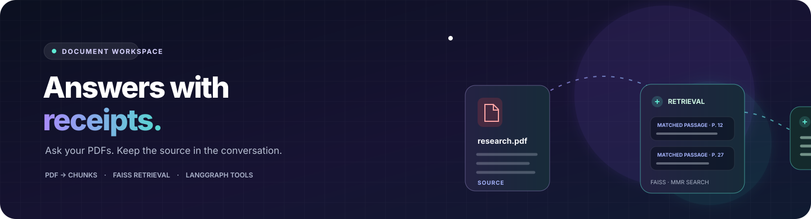
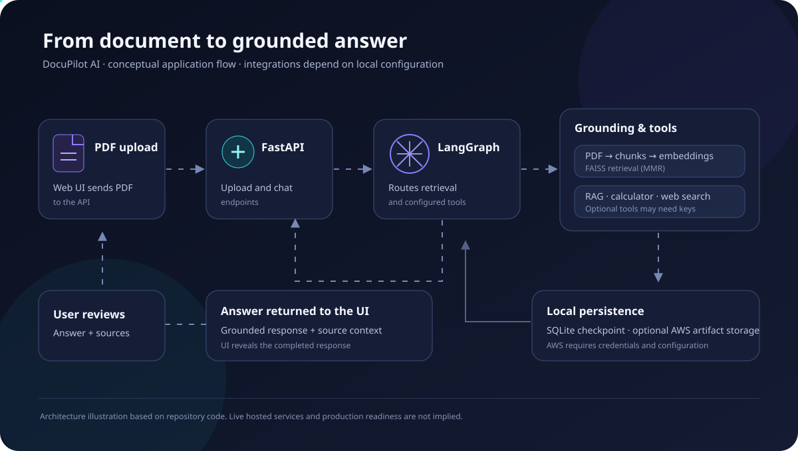

<h1>DocuPilot AI</h1>

<strong>Turn long PDFs into a focused, source-grounded conversation.</strong>

<a href="https://github.com/Geetansh124/DocuPilot-AI">Repository</a> · <a href="#quick-start">Quick start</a> · <a href="#how-it-works">How it works</a> · <a href="#limitations">Limitations</a>

    

> **Project status:** local development project. No public deployment or hosted demo is currently verified.

## What it does

Upload a PDF, let DocuPilot split it into searchable chunks, and ask questions in a chat tied to that conversation. A LangGraph workflow calls the NVIDIA chat model and can use document retrieval, web search, a calculator, stock lookup, and a Ruflo routing helper. A Streamlit interface is also included alongside the Next.js client.

## At a glance

| Capability | What the code currently does |
|---|---|
| PDF knowledge | Loads PDF pages, creates overlapping text chunks, embeds them with all-MiniLM-L6-v2, and builds a FAISS retriever. |
| Grounded chat | Retrieves relevant chunks for a thread and passes document context into the LangGraph chat workflow. |
| Conversation history | Uses LangGraph's SQLite checkpointer and thread IDs. |
| Assistant tools | Includes DuckDuckGo search, arithmetic, optional Alpha Vantage stock lookup, PDF retrieval, and Ruflo routing. |
| Web client | Next.js 14 interface with PDF upload, recent conversations, and a typewriter-style answer reveal. |
| Alternate UI | Streamlit interface with chat, PDF upload, recent threads, and tool status. |
| Optional persistence | S3/DynamoDB adapter for uploaded documents and FAISS artifacts when configured. |

## Product flow

The diagram describes the implemented local application flow. It does not imply that a hosted service or external provider is configured for you.

## How it works

1. **Start a conversation.** The client creates a thread ID used by the API and LangGraph checkpointer.
2. **Upload a PDF.** The API accepts PDF files up to 200 MB, loads pages with PyPDF, and splits text into 1,000-character chunks with 200-character overlap.
3. **Build retrieval.** Hugging Face sentence-transformer embeddings create a FAISS index. Retrieval uses maximal marginal relevance (k=5, fetch_k=15).
4. **Ask a question.** LangGraph invokes the NVIDIA model with the current conversation and document context. The graph can call its registered tools.
5. **Review the answer.** The API returns the completed response; the Next.js UI reveals it with a typewriter effect. The Streamlit UI uses its own message streaming loop.

## Quick start

### Requirements

- Python 3.10 or newer
- Node.js 18 or newer for the Next.js interface
- An NVIDIA API key for chat responses
- Optional: an Alpha Vantage API key for stock lookup; AWS credentials plus an S3 bucket for optional persistence
- Optional: Node.js/npm/npx and a working Ruflo setup for the Ruflo routing helper

### 1. Start the API

From the repository root:

~~~powershell
py -3 -m venv .venv
& .venv/Scripts/python.exe -m pip install --upgrade pip
& .venv/Scripts/python.exe -m pip install -r requirements.txt
~~~

Create a root .env file containing your own NVIDIA key:

~~~env
NVIDIA_API_KEY=your_nvidia_api_key
ALPHAVANTAGE_API_KEY=
FRONTEND_ORIGIN=http://localhost:3000
~~~

Then run:

~~~powershell
& .venv/Scripts/python.exe -m uvicorn api_server:app --reload --port 8000
~~~

The API health route is available at http://localhost:8000/health.

### 2. Start the Next.js interface

In a second terminal:

~~~powershell
cd frontend
npm install
Copy-Item .env.example .env.local
npm run dev
~~~

Open http://localhost:3000. The frontend's NEXT_PUBLIC_API_URL defaults to http://localhost:8000; set it in frontend/.env.local if the API is running elsewhere. The API's FRONTEND_ORIGIN must include the frontend origin for browser requests.

### Streamlit alternative

With the Python dependencies installed, run this from the repository root:

~~~powershell
& .venv/Scripts/python.exe -m streamlit run streamlit_rag_frontend.py
~~~

## API routes

| Method | Route | Purpose |
|---|---|---|
| GET | /health | Basic API health response. |
| GET | /api/threads | List saved chat threads and message summaries. |
| POST | /api/threads | Create a thread ID. |
| GET | /api/threads/{thread_id} | Read a thread's messages and in-memory document metadata. |
| POST | /api/chat | Run a chat turn and return its answer and tool names. |
| POST | /api/threads/{thread_id}/document | Upload and index a PDF for a thread. |

## Configuration

| Variable | Required | Purpose |
|---|---:|---|
| NVIDIA_API_KEY | For chat | Authenticates the NVIDIA model client. |
| ALPHAVANTAGE_API_KEY | No | Enables stock-price lookup. |
| FRONTEND_ORIGIN | No | Comma-separated browser origins allowed by CORS; defaults to localhost ports 3000 and 3001. |
| AWS_S3_BUCKET | No | Enables the optional AWS storage adapter when credentials are available. |
| AWS_DYNAMODB_TABLE | No | Metadata table name; defaults to docupilot-documents. |
| AWS_REGION | No | AWS region; defaults to us-east-1. |
| NEXT_PUBLIC_API_URL | No | Frontend API base URL; defaults to http://localhost:8000. |

Never commit API keys or cloud credentials. Keep real secrets in your local environment or deployment secret manager.

## Repository map

~~~text
.
├── api_server.py              # FastAPI endpoints and CORS
├── langraph_rag_backend.py    # LangGraph workflow, model, tools, FAISS retrieval
├── aws_storage.py             # Optional S3/DynamoDB adapter
├── streamlit_rag_frontend.py  # Streamlit alternative UI
├── frontend/                  # Next.js 14 client
├── tests/                     # Backend unit tests
└── requirements.txt           # Python dependencies
~~~

## Limitations

- **No verified hosted demo:** run the project locally; a working deployment has not been confirmed.
- **Model access is external:** chat needs a valid NVIDIA API key and network access to its model service.
- **Ruflo helper is an external runtime dependency:** the workflow attempts Ruflo routing through npx; availability depends on the local Node/npm environment and Ruflo setup.
- **State is partly process-local:** the default SQLite checkpointer stores conversation checkpoints locally, while active retrievers and document metadata are held in memory. The optional AWS adapter does not by itself make every part of chat state durable.
- **PDF extraction has limits:** scanned/image-only PDFs may need OCR, which is not implemented here.
- **Treat answers as assistive:** verify important claims against the source document and original sources.

## License

Released under the [MIT License](LICENSE).

Built for document exploration with retrieval, tools, and human review.

